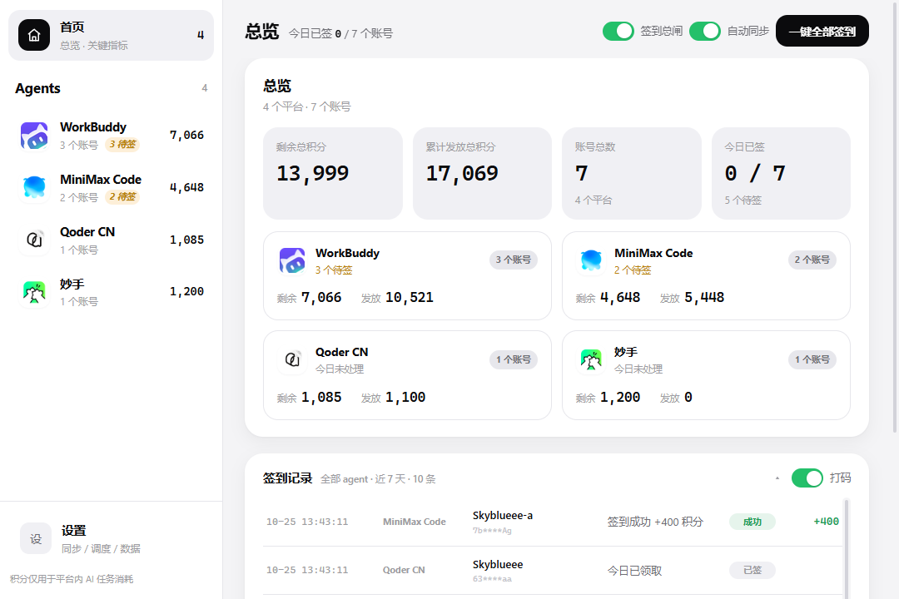
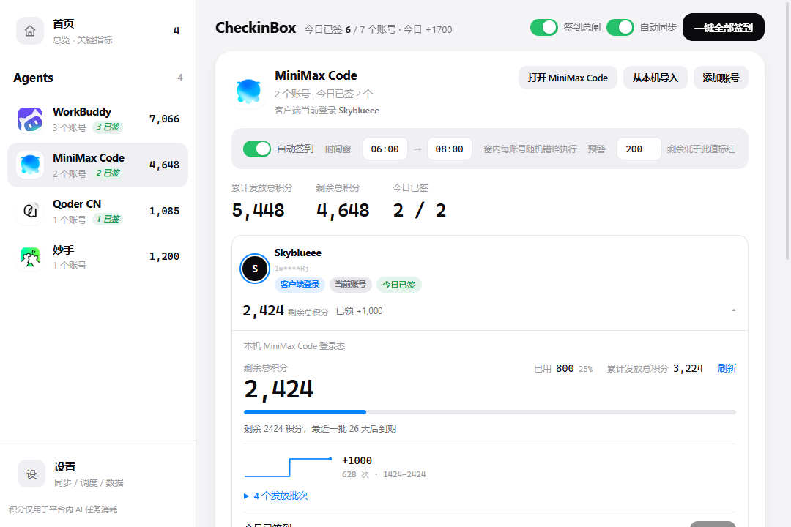
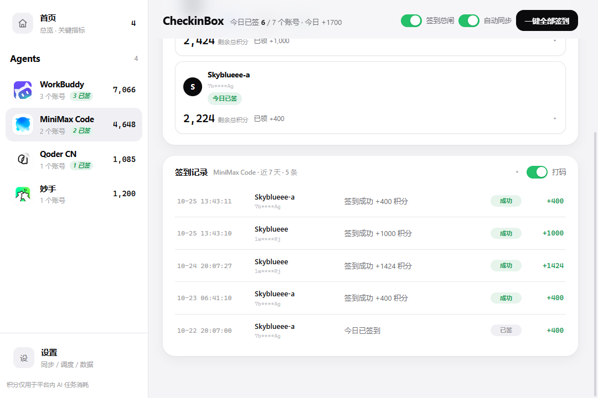

# CheckinBox

> 把散落在各个 AI 编程工具里的「每日领取积分」，收进一个窗口。

   

**CheckinBox** 是一个 Windows 桌面小工具：把本机已登录的 AI 编程客户端接进来，
统一查看各账号积分、按平台自己的活动刷新时刻自动签到、多账号一键切换客户端登录、
看签到流水和积分趋势。**多账号可以同时"活着"**——不在客户端里的账号也会自动续期、照常签到。

## 界面一览

**首页总览**——所有平台的关键指标和积分，一屏看全：



**Agent 面板**——账号小卡片（点击展开详情：积分明细 / 用量条 / 趋势 / 批次）：


展开详情（趋势迷你图悬浮可看每次快照的时间和剩余积分）：



**拖拽调序**——按住侧栏任意 agent 上下拖，浮动卡 + 骨架槽 + 平滑让位：


**签到记录**——按 agent 过滤，账号 id 副名字（可打码），同名账号也能分清：



## 支持的平台

| 平台 | 客户端登录态 | 每日签到 | 积分查询 | 客户端换号 | 账号导入方式 |
|---|---|---|---|---|---|
| **MiniMax Code** | `~/.minimax/auth/**/auth.json`（明文） | ✅ 每日领取，连签有额外加成 | ✅ | ✅ | 本机导入 / 浏览器设备码授权 |
| **Qoder CN** | Electron safeStorage（`auth.v1.dat`） | ✅ 活动领取制，每天 10:00 刷新 | ✅ | ✅ | 浏览器设备授权 |
| **WorkBuddy**（腾讯 CodeBuddy） | `state.vscdb`（safeStorage） | ✅ 签到活动制 | ✅ | — | 本机导入 / **Cockpit Tools 账号库**（多账号） |
| **妙手**（美团 CatPaw） | `~/.meituan-catpaw/auth.json`（明文） | ❌ 无每日签到（只有注册奖励） | ✅ | ✅ | 本机导入 |

> 上游接口都是**非公开的**，随时可能变。**核心原则：失败就如实报错**——本工具宁可显示
> 「签到失败：xxx」，也不会谎报「已签到」。

## 核心功能

### 多账号，且都是"活的"

客户端同一时刻只能登一个账号，但 CheckinBox 里的每个账号都能保持活跃（借鉴
[Cockpit Tools](https://github.com/jlcodes99/cockpit-tools) 的方案）：

- **当前登录的账号**：每次同步自动捕获客户端续期后的最新凭据回账号池
- **不在客户端里的账号**：token 临过期时自动走 OAuth 刷新（refresh token 轮换回写），
  早上的自动签到它照样能签
- **切换客户端账号**：一条龙——自动关闭客户端 → 捕获当前登录 → 备份 → 写入目标凭据
  → 以目标账号重启，全程不用你手动退出

### 自动签到

- 每个平台**独立的时间窗**（如 Qoder 是 10:00–11:00，其他默认 06:00–08:00），
  窗内给每个账号随机分配错峰分钟
- 窗内补跑：晚启动软件也不会整天漏签；改时间窗会自动重排
- 自动同步：按平台各自的间隔刷新积分 / 状态 / 昵称；**跨天强制同步**，"今日已签"
  不会停在昨天的状态
- 系统托盘常驻：左键显示窗口，右键菜单「立即全部签到 / 退出」

### 积分与趋势

- 每账号：剩余 / 已用 / 发放、用量条、发放批次明细、**最近 7 天趋势迷你图**
  （悬浮显示每次快照的时间和剩余积分）
- 低于预警阈值自动标红（阈值每个平台可调）
- 签到流水按月落盘（JSONL），按平台过滤，账号 id 副名字可打码

### 多账号管理

- 账号小卡片：收起显示关键信息，点击展开完整详情
- 「客户端登录」徽标 + 平台色头像描边——谁是客户端现场一眼可见
- 侧栏拖拽调序，顺序持久化
- 首页总览：全局关键指标 + 各平台积分卡，一屏看全

## 快速开始

### 环境要求

- Windows 10/11（凭据用 DPAPI 加密，绑定本机本用户）
- Node 18+、Rust stable（`rust-version = 1.77`）
- WebView2 运行时（Win11 自带；Win10 可能需装 Evergreen Runtime）

```bash
npm install                 # 前端依赖
npm run tauri:dev           # 开发模式运行
```

### 打包独立 exe（免装环境，约 4.3 MB）

```bash
npx tauri build --no-bundle
```

产物：`src-tauri/target/release/CheckinBox.exe`。

> ⚠️ 三个坑（都踩过）：
> 1. 直接 `cargo build --release` **不会**走 Tauri 的前端嵌入流程，产物会加载
>    `devUrl`（localhost）而白屏——必须用 `tauri build`。
> 2. `npm run tauri build -- --no-bundle` 里的 `--no-bundle` 会被 npm 吃掉，用 `npx`。
> 3. shell 里找不到 `cargo` 时把 `%USERPROFILE%\.cargo\bin` 加进 PATH；
>    构建前**关掉正在运行的 CheckinBox**（占用 exe 会静默失败）。

### 打包安装程序（NSIS / MSI）

```bash
npx tauri build
```

产物在 `src-tauri/target/release/bundle/`：

| 文件 | 大小 | 说明 |
|---|---|---|
| `nsis/CheckinBox_0.1.0_x64-setup.exe` | 约 2.1 MB | **推荐**：中文安装向导，用户级安装 |
| `msi/CheckinBox_0.1.0_x64_zh-CN.msi` | 约 3.5 MB | 企业部署（组策略/批量分发） |

安装行为（遵循标准 Windows 软件流程，参考 Cockpit Tools 的配置）：

- **用户级安装**（`installMode: currentUser`）：不需要管理员权限，
  装到 `%LOCALAPPDATA%\CheckinBox\`，快捷方式只影响当前用户
- 开始菜单创建「CheckinBox」快捷方式；卸载入口在
  **设置 → 应用 → 安装的应用** 和开始菜单里
- 卸载时会移除程序文件、快捷方式和卸载注册表项；
  **`%APPDATA%\AgentCheckinTools\` 数据目录会保留**（账号池和签到历史不丢），
  想彻底清掉手动删除该目录即可
- 静默安装/卸载：`setup.exe /S`、`uninstall.exe /S`（脚本/批量场景）

### 命令行入口（不启 GUI）

```bash
# 自检：DPAPI 加解密 → 时区 → 各平台发现/状态/积分 → safeStorage roundtrip
.\src-tauri\target\release\CheckinBox.exe --selftest

# 把本机客户端登录态的账号全部导入（MiniMax / 妙手 / WorkBuddy）
.\src-tauri\target\release\CheckinBox.exe --import-local

# 命令行版浏览器授权（发起会话并落盘，轮询交给应用）
.\src-tauri\target\release\CheckinBox.exe --device-auth qoder

# 命令行版切换客户端账号（自动关客户端 → 备份 → 写入 → 重启）
.\src-tauri\target\release\CheckinBox.exe --switch-client minimax <account_id>
```

### 测试

```bash
cd src-tauri && cargo test   # Rust 单测：调度 / Qoder 活动周期 / OSCrypt / 客户端定位
npm test                     # 前端测试：分组聚合 / 账号卡 / 签到记录
```

## 用法

1. **导入账号**：MiniMax / 妙手 / WorkBuddy 点「从本机导入」读本机客户端登录态；
   MiniMax / Qoder / WorkBuddy 也可以点「添加账号」走一次浏览器授权。
   装了 Cockpit Tools 的话，WorkBuddy 会自动读取它的加密账号库（多账号一次进来）。
2. **一键全部签到**：遍历所有账号，先查状态，需要才领取。
3. **自动签到**：总闸 + 每个平台自己的开关和时间窗，嵌在各平台面板顶部。
4. **切换客户端账号**：点账号卡里的「切换并打开客户端」，一条龙完成（客户端在运行
   也会被自动关闭再重启）。切走之前，当前登录的账号会被自动捕获进账号池，谁都不丢。
5. **首页总览**：侧栏顶部「首页」，所有平台的积分和签到状态一屏看全。

## 实现要点

### MiniMax Code

- 签到接口必须带 `?timezone_id=<IANA>`（Windows 时区名经注册表映射），否则
  `1406010011 invalid timezone_id`
- token 约 1 小时寿命，每次请求前重读本机登录态；401 时按「客户端是否在运行 /
  是否登录的此账号」快速失败并给出可操作的提示
- **登录态记录键的 hash 是设备级的**（换号不变）——账号 id 必须用客户端配置里的
  `sharedUser.userID`，身份判定用 token 调 `/v1/api/user/info` 实测
- OAuth 刷新：`POST account.minimax.cn/oauth2/token`，**refresh token 每次轮换**，
  刷新后必须回写；绝不能刷「客户端当前登录」的账号（会让客户端掉登录）
- 客户端有带防篡改围栏的鉴权状态机：写凭据必须**连同 `auth-state.json` 一起写**
  （generation 严格一致），否则客户端启动直接弹重新登录

### Qoder CN

- 签到是「活动领取制」：先拉活动列表再领取，**只认 `benefit.kind == CREDITS` 的活动**
- 活动周期按「今天 10:00 起的窗口」判定（活动行是跨天窗口），不能拿昨天的
  CLAIMED 当成今天已签
- 请求必须带设备风控头 `Cosy-MachineToken/MachineCode/MachineType`
  （本机 `~/.qoder-cn/umid-cache.json`）
- 登录态 `%APPDATA%\com.qodercn.app.stable\auth.v1.dat` 是 Electron safeStorage
  （`v10` + AES-256-GCM，密钥在 `Local State` 里由 DPAPI 保护）——同一 Windows 用户
  可解可写，换号即「解密 → 改 → 重加密」

### WorkBuddy（腾讯 CodeBuddy）

- 凭据在 `%APPDATA%\CodeBuddy\User\globalStorage\state.vscdb`（SQLite **TEXT** 列）
  的 safeStorage Buffer，解密链和 Qoder 同款
- 接口基址**跟随账号 domain**（`www.workbuddy.cn` / `www.codebuddy.cn` / 国际版 `.ai`）；
  网关要求浏览器 UA + `X-User-Id` + `X-Domain` 头，少一个 401
- 兼容 Cockpit Tools 的加密账号库（AES-256-GCM，密钥在其数据目录）

### 凭据保护

所有 token 用 **Windows DPAPI** 加密后落盘（`accounts.json`），换用户/换机器读不到；
明文只存在于内存。日志和界面里不出现任何 token。

### 调度模型

时间窗 + 每账号**确定性随机**分钟偏移（FNV-1a，同账号同一天重启不变），
窗内补跑 + 时间窗变更重排；调度配置按平台独立；自动同步跨天强制一次。

## 数据目录

```
%APPDATA%\AgentCheckinTools\
  ├── config.json              应用配置（各平台调度/间隔/阈值/侧栏顺序）
  ├── accounts.json            账号池（凭据 DPAPI 加密后 base64）
  ├── scheduler_state.json     当日调度计划（每账号随机分钟偏移 + 今日已处理标记）
  ├── auth_pending.json        未完成的浏览器授权会话（重启后恢复轮询）
  ├── quota_history.jsonl      积分快照（趋势图数据源，最多 4000 条）
  └── logs\
      └── checkin-2026-10.jsonl  签到流水，按月分文件
```

> ⚠️ 目录名仍是 `AgentCheckinTools`（旧的内部名），**不是** `CheckinBox`——改名会让
> 已有账号池读不到。迁移方案见 `docs/PROJECT-STATUS.md`。

## 项目结构

```
src/                        React 前端
  App.tsx                   全局状态 + 命令调用 + 轮询
  components/               DashboardPanel / Sidebar / AgentGroupPanel / AccountCard
                            QuotaCard / TrendLine / LogPanel / SettingsPanel
  lib/api.ts                invoke 封装 + 事件订阅
  lib/groups.ts             overview → 分组（多账号排序）
  lib/mask.ts               账号 id 打码（卡片与记录共用）
  styles.css                全部样式（单文件，按区块分节注释）
src-tauri/src/
├── core/
│   ├── provider.rs         Provider trait + 领域模型
│   ├── store.rs            账号池持久化（DPAPI 加密凭据）
│   ├── dpapi.rs            CryptProtectData / CryptUnprotectData 绑定
│   ├── os_crypt.rs         Electron safeStorage（OSCrypt v10）加解密
│   ├── config.rs           应用配置（调度/间隔/阈值/侧栏顺序）
│   ├── scheduler.rs        时间窗 + 确定性随机偏移 + 跨天重排
│   ├── logging.rs          签到流水（按月 JSONL）
│   ├── quota_history.rs    积分快照
│   ├── paths.rs            数据目录布局 + 原子写
│   ├── launcher.rs         客户端 exe 动态定位 + 进程检测 + 关闭/启动
│   ├── client_switch.rs    改写客户端登录态实现换号（三平台）
│   └── tz.rs               Windows 时区名 → IANA
├── providers/              minimax.rs / qoder.rs / miaoshou.rs / workbuddy.rs
├── commands.rs             Tauri 命令层 + 调度器后台循环
├── tray.rs                 系统托盘
├── selftest.rs             --selftest 自检
└── lib.rs / main.rs        入口 + 命令行分发
docs/
├── PROJECT-STATUS.md       项目现状与交接（接手前必读）
└── images/                 README 截图
```

## 免责声明

调用的是各客户端的**非公开内部接口**，归各厂商所有，可能随时变更或下线。
本项目与各厂商无任何隶属、授权或合作关系，仅供个人学习自用，禁止商业用途。
使用前请自行评估并遵守相关服务条款与法律法规，风险由使用者承担。

---

> 接手这个项目（人或 AI）请先读 **[docs/PROJECT-STATUS.md](docs/PROJECT-STATUS.md)** ——
> 那里有现状、关键决策、已知坑和待办。
