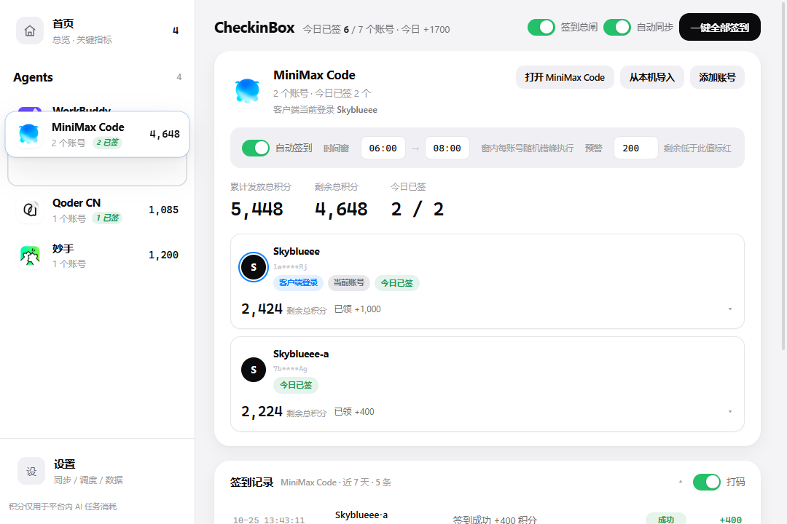

# CheckinBox

> 把散落在各个 AI 编程工具里的「每日领取积分」，收进一个窗口。

   

**CheckinBox** 是一个 Windows 桌面小工具：把本机已登录的 AI 编程客户端接进来，
统一查看各账号积分、按平台自己的活动刷新时刻自动签到、多账号一键切换客户端登录、
看签到流水和积分趋势。**多账号可以同时"活着"**——不在客户端里的账号也会自动续期、照常签到。

## 界面一览

**首页总览**——所有平台的关键指标和积分，一屏看全：


**Agent 面板**——账号方块卡片按窗口宽度并排展示，卡片直接显示余额，从明细入口查看用量、趋势和批次。


展开详情（趋势迷你图悬浮可看每次快照的时间和剩余积分）：


**拖拽调序**——按住侧栏任意 agent 上下拖，浮动卡 + 骨架槽 + 平滑让位：



**签到记录**——按 agent 过滤，账号 id 副名字（可打码），同名账号也能分清：


## 支持的平台

| 平台 | 客户端登录态 | 每日签到 | 积分查询 | 客户端换号 | 账号导入方式 |
|---|---|---|---|---|---|
| **MiniMax Code** | `~/.minimax/auth/**/auth.json`（明文） | ✅ 每日领取，连签有额外加成 | ✅ | ✅ | 本机导入 / 浏览器设备码授权 |
| **Qoder CN** | Electron safeStorage（`auth.v1.dat`） | ✅ 活动领取制，每天 10:00 刷新 | ✅ | ✅ | 浏览器设备授权 |
| **WorkBuddy**（腾讯 CodeBuddy） | `state.vscdb`（safeStorage） | ✅ 签到活动制 | ✅ | ✅ | 本机导入 / **Cockpit Tools 账号库**（多账号） |
| **妙手**（美团 CatPaw） | `~/.meituan-catpaw/auth.json`（明文） | ❌ 无每日签到（只有注册奖励） | ✅ | ✅ | 本机导入 |
| **Zcode**（智谱 Z.ai） | `~/.zcode/v2/credentials.json`（AES-256-GCM） | ⚠️ **只展示 + 提醒，不代领**（领取要过官方客户端的阿里云验证码） | ✅ 余额 / 已用 / 到期 | ❌ | 本机导入 |

> 上游接口都是**非公开的**，随时可能变。**核心原则：失败就如实报错**——本工具宁可显示
> 「签到失败：xxx」，也不会谎报「已签到」。
>
> **Zcode 特殊**：每日 3 亿 GLM-5.3-Flash Token 只能在官方客户端领取（阿里云验证码
> 只有在 Zcode 的 Electron 渲染进程里才生得出来）。所以 Zcode 面板只展示余额和
> 「待领取 / 已领取」状态，点「打开 Zcode 领取」会拉起官方客户端让你自己点。
>
> **领取提醒**：不写死时间（实测开放时刻并不固定，18:11 / 19:33 / 19:49 / 20:25 都见过），
> 而是轮询官方的 `billing/preview` 接口。出现「现在能领」的套餐时会保存一条应用内提醒，
> 每天每账号一条。在设置页的「应用内提醒」中可开关自动提醒。

## 核心功能

### 多账号，且都是"活的"

客户端同一时刻只能登一个账号，但 CheckinBox 里的每个账号都能保持活跃（借鉴
[Cockpit Tools](https://github.com/jlcodes99/cockpit-tools) 的方案）：

- **当前登录的账号**：每次同步自动捕获客户端续期后的最新凭据回账号池
- **不在客户端里的账号**：token 临过期时自动走 OAuth 刷新（refresh token 轮换回写），
  早上的自动签到它照样能签
- **切换客户端账号**：一条龙——自动关闭客户端 → 捕获当前登录 → 备份 → 写入目标凭据
  → 以目标账号重启，全程不用你手动退出

### 换号时保留聊天记录（WorkBuddy / Qoder）

借鉴 Cockpit Tools 的 `share_sessions_on_switch`：MiniMax 的会话存在**服务端**，
换号后客户端登录即自动拉取历史；而 WorkBuddy 和 Qoder CN 的会话/聊天记录存在
**本地**。WorkBuddy 在 agent 面板提供 **「换号同步聊天记录」**开关
（默认关，落盘 config.json 重启保持）：

- **勾选**：每次「切换客户端账号」时把会话记录带给目标账号——
  - WorkBuddy 5.x：会话索引在 `%USERPROFILE%\.workbuddy\workbuddy.db`，客户端按
    `sessions.user_id` 过滤。切换时先备份数据库，再将未删除会话归到目标账号 UID；
    旧版扩展目录仍执行文件级合并，目标已有会话不会被删除；
  - Qoder CN：会话索引/消息在 `main.sqlite`，项目会话正文在
    `%USERPROFILE%\.qoder-cn\projects\`。索引没有账号归属字段，因此本机各账号
    共用会话记录；切换时保留数据库和项目文件，不搬库、不清空。
    旧版 CheckinBox 若曾把会话库存进账号归档，新版会在切换时先备份现场，再把归档里的
    会话/消息及 `workspaces` 工作区目录合并回共享库；Qoder 的其他设置和凭据不参与合并。
- **不勾选**：换号完全不碰聊天数据（与旧版行为一致）。
- **与 MiniMax 的关系**：MiniMax 不显示也不需要这个开关——它的同步是客户端
  自己做的（服务端按账号下发），始终生效、优先于任何本地处理；本开关只管
  WorkBuddy 的本地记录；Qoder 的本地历史始终共享。
- 安全措施（**修改会话前先备份，宁可不同步也不丢数据**）：
  - WorkBuddy 合并、Qoder 旧归档恢复前，将涉及的数据库和 WAL/SHM 完整备份到
    `chat_history\<平台>\_backups\<操作id>\`（每次一个独立目录，不覆盖旧备份）；
  - 旧版 Qoder 账号归档保留供恢复使用；当前切号不再移动数据库；
  - WorkBuddy 只读来源账号，目标账号的会话**只增不删**；替换任何会话/索引前
    先把原目录/原文件整个移进备份；
  - sqlite 主库与 `-wal`/`-shm` 成组备份；旧版 Qoder 账号归档只合并聊天与工作区目录，
    不覆盖应用设置、凭据或迁移记录；
  - 客户端运行中拒绝执行；同步失败**不阻塞**换号本身，结果如实显示在切换提示里。
- **出问题怎么恢复**：到 `%APPDATA%\CheckinBox\chat_history\` 下找
  对应平台的 `_backups\<操作id>\`（时间戳最新的那次），把里面的文件复制回客户端
  数据目录即可（Qoder 是 `%APPDATA%\com.qodercn.app.stable\`，WorkBuddy 是
  `%LOCALAPPDATA%\CodeBuddyExtension\Data\`）。操作前请先完全退出客户端。
- **备份管理**：设置页新增「历史备份」tab，按平台列出每次换号备份的时间、大小、
  文件数和内容，可逐条删除或按「保留最近 N 天」批量清理（删除不可撤销，均有确认）。
  历史 Qoder 账号归档（`<账号id>\payload`）保留作恢复材料，不在列表里、也不允许删除。
- 附带把 **WorkBuddy 的客户端换号**补齐了（此前为「—」）：解密 state.vscdb 的
  safeStorage 登录态 → 以当前文件为模板改写身份与 token → 重新加密写回。首次
  真机换号时留意一下客户端登录结果（有 `.bak` 备份兜底）。

### 自动签到

- 每个平台**独立的时间窗**（如 Qoder 是 10:00–11:00，其他默认 06:00–08:00），
  窗内给每个账号随机分配错峰分钟
- 窗内补跑：晚启动软件也不会整天漏签；改时间窗会自动重排
- 自动同步：按平台各自的间隔刷新积分 / 状态 / 昵称；**跨天强制同步**，"今日已签"
  不会停在昨天的状态
- 系统托盘常驻。左键恢复窗口，右键可看提醒、签到记录、打开设置、立即签到或同步、隐藏窗口和退出。重复启动桌面应用时会恢复已有窗口。

### 后台可靠性

- **开机启动（静默驻留）**：设置页开启后，登录 Windows 自动启动到托盘，
  不弹窗、不抢焦点；自动签到不依赖你手动打开程序
- **应用内提醒**：后台签到失败、额度过低、7 天内到期或可领取时生成提醒。窗口隐藏时照常保存，重启后可以查看最近 100 条。托盘和窗口顶部显示未读数，设置页可关闭自动提醒或发送测试提醒。
- **积分到期**：首页「7 天内到期」按紧迫度列出账号与积分，账号小卡片显示
  「N 天到期」徽标；打开积分明细可看到「最近到期」和每个批次的到期日。
  到期时间以平台接口为准：MiniMax 每批积分都有到期日；WorkBuddy 取套餐
  `PackageEndTime`；Qoder 返回长期（界面显示「长期有效」）；妙手体验版
  不提供到期时间（显示「平台未提供」，只有「下次刷新」时间）

### 关闭窗口 / 后台驻留

- 点右上角 × 默认弹确认框：**最小化到系统托盘**（后台继续签到和同步）或**直接退出**，
  可勾选「记住我的选择，下次不再询问」
- 设置页「关闭窗口」随时可改成三选一：每次询问 / 最小化到托盘 / 直接退出；
  选择落盘 config.json，重启后保持
- 最小化后仍由托盘常驻：左键恢复窗口，右键「退出」彻底结束程序

### 积分与趋势

- 每账号：剩余 / 已用 / 发放、用量条、发放批次明细、**最近 7 天趋势迷你图**
  （悬浮显示每次快照的时间和剩余积分）
- 低于预警阈值自动标红（阈值每个平台可调）
- 签到流水按月落盘（JSONL），按平台过滤，账号 id 副名字可打码

### 多账号管理

- 账号卡片上可以直接打开或切换客户端、签到、设为当前账号、查看明细和移除账号。移除前会确认账号。WorkBuddy 明细提供有效与过期资源包及消耗记录。Zcode 按 Token 显示，Qoder 可查看 CheckinBox 记录的本地领取批次。
- 「客户端登录」徽标 + 平台色头像描边——谁是客户端现场一眼可见
- 侧栏拖拽调序，顺序持久化
- 首页总览：全局关键指标 + 各平台积分卡，一屏看全

## 快速开始

### 环境要求

- Windows 10/11（凭据用 DPAPI 加密，绑定本机本用户）
- Node 18+、Rust stable（`rust-version = 1.77`）
- WebView2 运行时（Win11 自带；Win10 可能需装 Evergreen Runtime）

```bash
npm install                 # 前端依赖
npm run tauri:dev           # 开发模式运行
```

### 打包独立 exe（免装环境，约 5 MB）

```bash
npx tauri build --no-bundle --features custom-protocol
```

产物：`src-tauri/target/release/CheckinBox.exe`。

> ⚠️ 四个坑（都踩过）：
> 1. 直接 `cargo build --release` **不会**嵌入前端界面，产物运行时会去连
>    `devUrl`（http://localhost:5173），窗口显示「localhost 拒绝连接」
>    （ERR_CONNECTION_REFUSED）错误页——必须用 `tauri build`，或手动加
>    `--features custom-protocol`。现在 `lib.rs` 有编译期护栏：忘带特性时
>    release 构建直接编译失败，不会再产出能跑但白屏的 exe。
> 2. **tauri-cli 2.12+ 不再自动带 `custom-protocol`**（实测 2.12.4：
>    `npx tauri build --no-bundle` 会直接撞上编译护栏），命令要显式写
>    `--features custom-protocol`。
> 3. `npm run tauri build -- --no-bundle` 里的 `--no-bundle` 会被 npm 吃掉，用 `npx`。
> 4. shell 里找不到 `cargo` 时把 `%USERPROFILE%\.cargo\bin` 加进 PATH；
>    构建前**杀掉正在运行的 CheckinBox**（占用 exe 会失败，报
>    `failed to remove file … 拒绝访问 (os error 5)`）。**不用问用户，直接杀**：
>    ```bash
>    taskkill //IM CheckinBox.exe //F     # Git Bash 语法；PowerShell 用 /IM /F
>    tasklist //FI "IMAGENAME eq CheckinBox.exe"   # 确认杀干净
>    ```
>    注意「关窗口」≠「进程结束」：关窗口行为可在设置里配，默认弹确认框
>    （最小化到托盘 / 退出），也可固定为「最小化到托盘」后台常驻 —— 所以要按
>    **进程名**确认。杀之前不用打招呼（用户明确要求），但要知道这会中断正在
>    跑的操作（调度签到 / 切换客户端）；构建完直接重新拉起 exe。
>    另外若进程没杀干净，直接双击新 exe 会因 WebView2 用户数据目录被占用而
>    静默退出（0x800700AA）。

### 打包安装程序（NSIS / MSI）

```bash
npx tauri build --features custom-protocol
```

> `--features custom-protocol` 同样不能省（见上面的坑 2）：少了它会撞上
> `lib.rs` 的编译期护栏，直接编译失败。

产物在 `src-tauri/target/release/bundle/`：

| 文件 | 大小 | 说明 |
|---|---|---|
| `nsis/CheckinBox_0.1.0_x64-setup.exe` | 约 2.1 MB | **推荐**：中文安装向导，用户级安装 |
| `msi/CheckinBox_0.1.0_x64_zh-CN.msi` | 约 3.5 MB | 企业部署（组策略/批量分发） |

安装行为（遵循标准 Windows 软件流程，参考 Cockpit Tools 的配置）：

- **用户级安装**（`installMode: currentUser`）：不需要管理员权限，
  装到 `%LOCALAPPDATA%\CheckinBox\`，快捷方式只影响当前用户
- 开始菜单创建「CheckinBox」快捷方式；卸载入口在
  **设置 → 应用 → 安装的应用** 和开始菜单里
- 卸载时会移除程序文件、快捷方式和卸载注册表项；
  **`%APPDATA%\CheckinBox\` 数据目录会保留**（账号池和签到历史不丢），
  想彻底清掉手动删除该目录即可
- 静默安装/卸载：`setup.exe /S`、`uninstall.exe /S`（脚本/批量场景）

### 命令行入口（不启 GUI）

```bash
# 自检：DPAPI 加解密 → 时区 → 各平台发现/状态/积分 → safeStorage roundtrip
.\src-tauri\target\release\CheckinBox.exe --selftest

# 把本机客户端登录态的账号全部导入（MiniMax / 妙手 / WorkBuddy）
.\src-tauri\target\release\CheckinBox.exe --import-local

# 命令行版浏览器授权（发起会话并落盘，轮询交给应用）
.\src-tauri\target\release\CheckinBox.exe --device-auth qoder

# 命令行版切换客户端账号（自动关客户端 → 备份 → 写入 → 重启）
.\src-tauri\target\release\CheckinBox.exe --switch-client minimax <account_id>

# 列出客户端登录态的多代备份（minimax / miaoshou / qoder）
.\src-tauri\target\release\CheckinBox.exe --list-client-backups minimax

# 回滚到指定的一代（操作 id 从上面的列表里取）
.\src-tauri\target\release\CheckinBox.exe --restore-client-backup minimax <操作id>
```

> release 版没有控制台，这两个命令的结果会写进
> `%APPDATA%\CheckinBox\client_login_backups\<平台>\_cli-output.txt` 并自动打开。

### 测试

```bash
cd src-tauri && cargo test   # Rust 单测：调度 / Qoder 活动周期 / OSCrypt / 客户端定位 / 聊天同步 / 数据目录迁移
npm test                     # 前端测试：分组聚合 / 账号卡 / 签到记录 / 设置页 / 备份管理
```

## 用法

1. **导入账号**：MiniMax / 妙手 / WorkBuddy 点「从本机导入」读本机客户端登录态；
   MiniMax / Qoder / WorkBuddy 也可以点「添加账号」走一次浏览器授权。
   装了 Cockpit Tools 的话，WorkBuddy 会自动读取它的加密账号库（多账号一次进来）。
2. **一键全部签到**：遍历所有账号，先查状态，需要才领取。
3. **自动签到**：总闸 + 每个平台自己的开关和时间窗，嵌在各平台面板顶部。
4. **切换客户端账号**：点账号卡里的「切换并打开客户端」，一条龙完成（客户端在运行
   也会被自动关闭再重启）。切走之前，当前登录的账号会被自动捕获进账号池，谁都不丢。
5. **首页总览**：侧栏顶部「首页」，所有平台的积分和签到状态一屏看全。
6. **关闭窗口**：首次点 × 会询问「最小化到托盘 / 退出」，可记住选择；
   之后在设置页「关闭窗口」里修改。托盘常驻时后台照常签到。
7. **开机启动 / 提醒**：设置页「开机启动」开启后静默驻留托盘。「应用内提醒」
   控制自动提醒，可发送测试提醒并打开提醒列表。

## 实现要点

### MiniMax Code

- 签到接口必须带 `?timezone_id=<IANA>`（Windows 时区名经注册表映射），否则
  `1406010011 invalid timezone_id`
- token 约 1 小时寿命，每次请求前重读本机登录态；401 时按「客户端是否在运行 /
  是否登录的此账号」快速失败并给出可操作的提示
- **登录态记录键的 hash 是设备级的**（换号不变）——账号 id 必须用客户端配置里的
  `sharedUser.userID`，身份判定用 token 调 `/v1/api/user/info` 实测
- OAuth 刷新：`POST account.minimax.cn/oauth2/token`，**refresh token 每次轮换**，
  刷新后必须回写；绝不能刷「客户端当前登录」的账号（会让客户端掉登录）
- **客户端运行中刷新护栏（2026-11-02 实测）**：身份探测是三态 `Same/Other/Unknown`。
  `Same` 只捕获不刷新；`Other` 可安全刷新；**`Unknown` 且客户端在运行时不刷新**——
  否则一次探测失败就可能把客户端手里的 RT 轮换掉，客户端下一次刷新直接
  `invalid_grant` 掉登录（实测 16:00:46 掉线）。401 抢救路径同样走这个判断
- 客户端有带防篡改围栏的鉴权状态机：写凭据必须**连同 `auth-state.json` 一起写**
  （generation 严格一致），否则客户端启动直接弹重新登录
- 积分接口每个批次带 `expire_at_ms`（毫秒），到期展示和 7 天提醒直接用这个字段
- **客户端运行态是三态（2026-11-12 加固）**：进程探测返回 `Running`/`Absent`/`Unknown`，
  不是布尔——布尔分不出「探测失败」和「确实没跑」。`Unknown` 一律按「可能在跑」处理，
  **不自动刷新**（宁可这次签到失败，也不顶掉客户端手里的 RT）。上游 cockpit-tools
  至今没有这层守卫，刷新时抄客户端 RT 去用，RT 一轮换客户端就掉线
- **换号备份按「代」成组留存（2026-11-12 加固）**：每次换号把 `auth.json` 与
  `auth-state.json` 存成一「代」，落在 `%APPDATA%\CheckinBox\client_login_backups\`，
  可列出、回滚、删除、裁剪（命令行 / Tauri 命令，设置页 UI 尚未接入）
- **设备授权导入会记下客户端登录态路径**（`auth_file`）：只记路径、不取文件里的凭据，
  避免把客户端当前登录号的会话串到别的账号上
- 详细的加固设计与实施记录见 `docs/minimax-hardening/`

### Qoder CN

- 签到是「活动领取制」：先拉活动列表再领取，**只认 `benefit.kind == CREDITS` 的活动**
- 活动周期按「今天 10:00 起的窗口」判定（活动行是跨天窗口），不能拿昨天的
  CLAIMED 当成今天已签
- 请求必须带设备风控头 `Cosy-MachineToken/MachineCode/MachineType`
  （本机 `~/.qoder-cn/umid-cache.json`）
- 登录态 `%APPDATA%\com.qodercn.app.stable\auth.v1.dat` 是 Electron safeStorage
  （`v10` + AES-256-GCM，密钥在 `Local State` 里由 DPAPI 保护）——同一 Windows 用户
  可解可写，换号即「解密 → 改 → 重加密」
- 积分接口的 `qoderUsage.expiresAt` 实测是 9999 年（长期），界面显示「长期有效」
- 网页端有更细的「资源包」明细（`GET https://qoder.cn/api/v2/me/usages/big_model_credits`，
  返回每个 100 Credits 包的 `expiresAt`），但**需要网页登录 Cookie + `X-CSRF-TOKEN`**；
  账号的设备 token 调用返回 401。本工具改用签到日志回填「每日领取记录（本地）」，
  显示领取时间 + 30 天到期；客户端里手动领的、或首次使用前领的批次无法还原

### WorkBuddy（腾讯 CodeBuddy）

- 凭据在 `%APPDATA%\WorkBuddy\User\globalStorage\state.vscdb`（SQLite **TEXT** 列）
  键 `secret://{"extensionId":"tencent-cloud.coding-copilot","key":"planning-genie.new.accessTokencn"}`
  的 safeStorage Buffer，解密链和 Qoder 同款（旧版 CodeBuddy 客户端才用
  `%APPDATA%\CodeBuddy` + `accessToken`，本工具不接管）
- 接口基址**跟随账号 domain**（`www.workbuddy.cn` / `www.codebuddy.cn` / 国际版 `.ai`）；
  网关要求浏览器 UA + `X-User-Id` + `X-Domain` 头，少一个 401
- 兼容 Cockpit Tools 的加密账号库（AES-256-GCM，密钥在其数据目录）
- **导入后凭据复制进本工具账号池**（DPAPI 加密），运行时不依赖 Cockpit；
  两边同时续期同一个账号可能互相轮换 refresh token，建议一个账号只由一个工具负责续期
- **积分到期取 `PackageEndTime`**（实测 `CycleEndTime` 在纯积分包上常为 0）；
  数值兼容秒/毫秒，也兼容 `YYYY-MM-DD HH:mm:ss` 字符串

### 妙手（美团 CatPaw）

- 鉴权要**同时**带 `X-Auth-Token` 和 `access-token`（同值），少一个 `4011`
- **没有每日签到**：积分来自套餐，别去实现「每日领取」
- **`nextRefreshTime` 是套餐刷新时间，不是积分到期**：到期取订阅接口的
  `expireTime`；体验版实测不返回该字段，界面如实显示「平台未提供」。
  下次刷新时间单独一行显示（本地日期），注册奖励/每月发放的历史流水接口不提供

### 凭据保护

所有 token 用 **Windows DPAPI** 加密后落盘（`accounts.json`），换用户/换机器读不到；
明文只存在于内存。日志和界面里不出现任何 token。

### 调度模型

时间窗 + 每账号**确定性随机**分钟偏移（FNV-1a，同账号同一天重启不变），
窗内补跑 + 时间窗变更重排；调度配置按平台独立；自动同步跨天强制一次。

## 数据目录

```
%APPDATA%\CheckinBox\
  ├── config.json              应用配置（各平台调度/间隔/阈值/侧栏顺序/聊天同步开关/关闭行为/提醒开关）
  ├── notifications.json       最近 100 条应用内提醒及已读状态
  ├── accounts.json            账号池（凭据 DPAPI 加密后 base64）
  ├── scheduler_state.json     当日调度计划（每账号随机分钟偏移 + 今日已处理标记）
  ├── auth_pending.json        未完成的浏览器授权会话（重启后恢复轮询）
  ├── quota_history.jsonl      积分快照（趋势图数据源，最多 4000 条）
  ├── chat_history\            换号同步的聊天记录归档（WorkBuddy 合并备份 / Qoder 每账号一份聊天库）
  ├── client_login_backups\    客户端登录态的多代备份（换号前现场，可回滚）
  │   └── <平台>\<操作id>\     auth.json + auth-state.json + meta.json
  └── logs\
      └── checkin-2026-10.jsonl  签到流水，按月分文件
```

> 旧版本的数据目录叫 `%APPDATA%\AgentCheckinTools\`。新版首次启动时会把它**整目录复制**
> 到 `%APPDATA%\CheckinBox\`（新目录已存在则不动，绝不覆盖），旧目录原样保留作备份；
> 确认新目录数据正常后可手动删除旧目录。

## 项目结构

```
src/                        React 前端
  App.tsx                   全局状态 + 命令调用 + 轮询
  components/               DashboardPanel / Sidebar / AgentGroupPanel / AccountCard
                            QuotaCard / TrendLine / LogPanel / SettingsPanel / BackupPanel
                            CloseConfirmDialog
  lib/api.ts                invoke 封装 + 事件订阅
  lib/groups.ts             overview → 分组（多账号排序）
  lib/mask.ts               账号 id 打码（卡片与记录共用）
  styles.css                全部样式（单文件，按区块分节注释）
src-tauri/src/
├── core/
│   ├── provider.rs         Provider trait + 领域模型
│   ├── store.rs            账号池持久化（DPAPI 加密凭据）
│   ├── dpapi.rs            CryptProtectData / CryptUnprotectData 绑定
│   ├── os_crypt.rs         Electron safeStorage（OSCrypt v10）加解密
│   ├── config.rs           应用配置（调度/间隔/阈值/侧栏顺序）
│   ├── scheduler.rs        时间窗 + 确定性随机偏移 + 跨天重排
│   ├── logging.rs          签到流水（按月 JSONL）
│   ├── quota_history.rs    积分快照
│   ├── paths.rs            数据目录布局 + 原子写
│   ├── launcher.rs         客户端 exe 动态定位 + 进程检测 + 关闭/启动
│   ├── client_switch.rs    改写客户端登录态实现换号（四平台）
│   ├── chat_sync.rs        换号会话处理（WorkBuddy 合并 / Qoder 本地历史共享 + 备份管理）
│   └── tz.rs               Windows 时区名 → IANA
├── providers/              minimax.rs / qoder.rs / miaoshou.rs / workbuddy.rs
├── commands.rs             Tauri 命令层 + 调度器后台循环
├── tray.rs                 系统托盘
├── selftest.rs             --selftest 自检
└── lib.rs / main.rs        入口 + 命令行分发
docs/
├── PROJECT-STATUS.md       项目现状与交接（接手前必读）
└── images/                 README 截图
```

## 免责声明

调用的是各客户端的**非公开内部接口**，归各厂商所有，可能随时变更或下线。
本项目与各厂商无任何隶属、授权或合作关系，仅供个人学习自用，禁止商业用途。
使用前请自行评估并遵守相关服务条款与法律法规，风险由使用者承担。

---

> 接手这个项目（人或 AI）请先读 **[docs/PROJECT-STATUS.md](docs/PROJECT-STATUS.md)** ——
> 那里有现状、关键决策、已知坑和待办。
