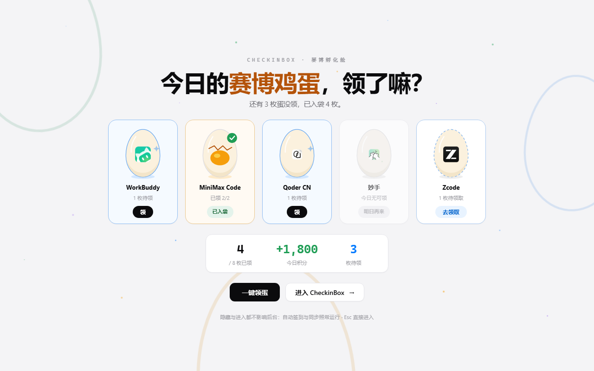
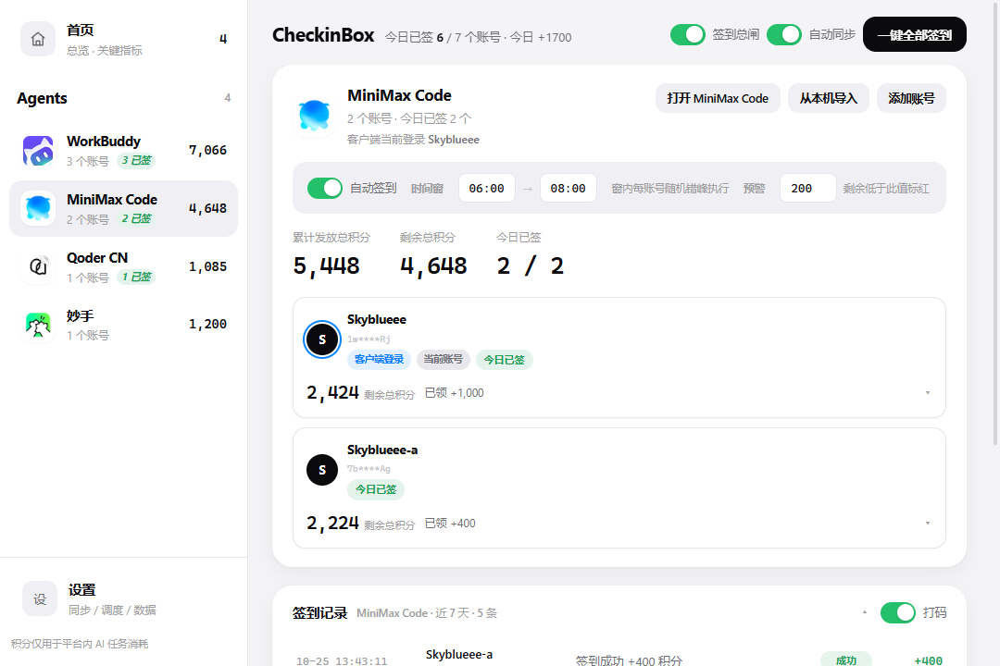

# CheckinBox

> 今日的赛博鸡蛋，领了嘛？

   

**CheckinBox** 是一个 Windows 桌面工具，把本机已登录的 AI 编程客户端接进来。

每次启动先打开「赛博孵化舱」：每个平台一枚蛋，今天能领的会发光，点一下就能领；
领完直接进主界面。之后的事交给后台——自动签到、多账号凭据保鲜、换号保留聊天记录、
积分趋势和提醒，都收在同一个窗口里。



## 赛博鸡蛋：每天第一眼就知道领没领

- **一个平台一枚蛋**：已领是裂壳金蛋，可领是青光脉动，需手动领取是青圈，空巢 / 今日无可领是暗蛋，读取失败可以当场重试。
- **点「领」就领**：单个平台会把该平台所有可签账号依次签完；「一键领蛋」扫描全部平台，只处理真正可领的账号。
- **数字一眼看清**：已领 / 总账号、今日积分、还剩几枚待领，与主界面同一口径。
- **不挡路**：每次进程启动只展示一次，进入主界面后不再弹出；托盘唤醒直接进主界面。顶栏的蛋图标可以随时打开封面浮层再看一眼，Esc / 返回回到原页面，导航状态不丢。
- **隐藏不等于停用**：在侧栏 Agents 旁的眼睛按钮里可以关掉某平台的侧栏、首页卡片或封面蛋。隐藏只影响显示，自动签到与后台同步照常运行。

## 核心能力

### 自动领取积分

- 每个平台独立的时间窗（Qoder 跟随每天 10:00 的活动刷新，其他平台默认 06:00–08:00），窗内给每个账号分配**确定性随机分钟**——同账号同一天重启也不变，避免同一秒打爆上游接口。
- 窗内补跑：晚开软件不会整天漏签；修改时间窗会自动重排。
- **总闸 + 每平台开关**：关掉总闸后所有 agent 都不跑；单个平台可以单独停。
- **自动同步**：按平台各自的间隔刷新积分、签到状态和账号资料；跨天强制同步一次，保证「今日已签 / 今日可签」不会停在昨天。
- **失败如实报错**：宁可显示「签到失败：xxx」，也不谎报「已签到」。失败流水有 10 分钟节流，不会刷屏。
- **前台刷新可调**：设置页提供界面自动刷新间隔（0 / 15 / 30 / 45 / 60 / 120 / 300 / 600 秒或自定义 10–3600 秒），与后台同步间隔相互独立；设为 0 后只在手动刷新或后台同步完成时更新界面。

### 多账号管理

- **两个入口**：点「从本机导入」读取本机客户端登录态（MiniMax / Qoder / 妙手 / WorkBuddy / Zcode）；MiniMax / Qoder / WorkBuddy 也可以点「添加账号」走浏览器设备授权。
- **账号池里的每个号都是「活的」**：客户端同一时刻只能登一个账号，但 CheckinBox 会给不在客户端的账号自动续期（refresh token 轮换后回写），早上的自动签到照样能签。
- **一眼分清账号**：账号卡显示「客户端登录」徽标和平台色头像描边；支持设为当前账号、签到、打开/切换客户端、查看明细、刷新积分或额度、移除账号。
- **侧栏拖拽调序**，顺序持久化；隐藏平台不会打乱剩余平台的顺序。
- **积分与趋势**：每账号显示剩余 / 已用 / 发放、用量条、发放批次明细、最近 7 天趋势迷你图；低于预警阈值自动标红。
- **到期与福利**：首页列出 7 天内到期账号与积分；福利条统一展示积分/额度与免费模型。WorkBuddy 的免费模型清单会从模型目录实时核对，并标注核对月份。

### 切换账号，会话留存

客户端同一时刻只能登一个账号。切号不是简单改个 token：

- **一条龙切换**：自动关闭客户端 → 捕获当前登录态 → 多代备份 → 写入目标凭据 → 以目标账号重启，全程不用手动退出。
- **客户端运行中护栏**：身份探测分 `Same / Other / Unknown` 三态。客户端正在运行且状态未知时**不自动刷新**——宁可这次签到失败，也不把客户端手里的 refresh token 轮换掉导致掉登录。
- **会话留存（WorkBuddy / Qoder）**：
  - WorkBuddy 在面板里有 **「换号同步聊天记录」** 开关（默认关）：开启后切号会把本地会话带给目标账号，目标账号已有会话只增不删。
  - Qoder 的本地会话索引没有账号归属字段，各账号共用；切号只保留、不搬库、不清空。
  - MiniMax 的会话存在服务端，换号后客户端登录即自动拉取，不需要本地处理。
- **改之前先备份**：WorkBuddy 会话合并、Qoder 旧归档恢复前，都会把数据库与 WAL/SHM 完整备份到独立目录；每次换号的客户端凭据也按「代」留存，可列出、回滚、裁剪。
- **同步失败不阻塞换号**：结果如实显示在切换提示里；客户端运行中拒绝执行会话修改。

### 托盘、后台与提醒

- 点窗口右上角 × 默认询问「最小化到托盘 / 直接退出」，可记住选择；设置页随时可改。
- 托盘左键恢复窗口，右键查看提醒、签到记录、打开设置、立即签到/同步、隐藏窗口和退出。
- 开机启动（静默驻留）：登录 Windows 后直接进托盘，不弹窗、不抢焦点，后台签到不依赖手动打开程序。
- 应用内提醒：签到失败、额度过低、7 天内到期或出现可领取时生成提醒；窗口隐藏时照常保存，重启后可查看最近 100 条，可发送测试提醒。

## 支持的平台

| 平台 | 客户端登录态 | 每日签到 | 积分查询 | 客户端换号 | 账号导入方式 |
|---|---|---|---|---|---|
| **MiniMax Code** | `~/.minimax/auth/**/auth.json`（明文） | ✅ 每日领取，连签有额外加成 | ✅ | ✅ | 本机导入 / 浏览器设备码授权 |
| **Qoder CN** | Electron safeStorage（`auth.v1.dat`） | ✅ 活动领取制，每天 10:00 刷新 | ✅ | ✅ | 本机导入 / 浏览器授权 |
| **WorkBuddy**（腾讯 CodeBuddy） | `state.vscdb`（safeStorage） | ✅ 签到活动制 | ✅ | ✅ | 本机导入 / 浏览器授权 |
| **妙手**（美团 CatPaw） | `~/.meituan-catpaw/auth.json`（明文） | ❌ 无每日签到（只有注册奖励） | ✅ | ✅ | 本机导入 |
| **Zcode**（智谱 Z.ai） | `~/.zcode/v2/credentials.json`（AES-256-GCM） | ⚠️ 只展示 + 提醒，不代领 | ✅ 余额 / 已用 / 到期 | ❌ | 本机导入 |

> **Zcode 为什么只提醒不代领**：每日 3 亿 GLM-5.3-Flash Token 只能在官方客户端领取，
> 阿里云验证码只在 Zcode 的 Electron 渲染进程里生得出来。所以封面和面板会显示「待领取」，
> 点「去领取」拉起官方客户端，由你自己点。

> 所有上游接口都是**非公开的内部接口**，随时可能变。本工具的原则是失败就如实报错，
> 不猜字段、不谎报状态。

## 界面一览

**首页总览**——所有平台的关键指标和积分，一屏看全：


**Agent 面板**——账号方块卡片按窗口宽度并排展示，卡片直接显示余额：



展开详情（趋势迷你图悬浮可看每次快照的时间和剩余积分）：


**签到记录**——按 agent 过滤，账号 id 副名字可打码：


**拖拽调序**——按住侧栏任意 agent 上下拖，浮动卡 + 骨架槽 + 平滑让位：


## 快速开始

### 环境要求

- Windows 10/11（凭据用 DPAPI 加密，绑定本机本用户）
- Node 18+、Rust stable（`rust-version = 1.77`）
- WebView2 运行时（Win11 自带；Win10 可能需装 Evergreen Runtime）

```bash
npm install                 # 前端依赖
npm run tauri:dev           # 开发模式
```

### 使用流程

1. **导入账号**：点「从本机导入」读取本机客户端登录态（MiniMax / Qoder / 妙手 / WorkBuddy / Zcode）；MiniMax / Qoder / WorkBuddy 也可以点「添加账号」走浏览器授权。
2. **启动页领蛋**：每天打开先看赛博孵化舱，点「一键领蛋」或单个平台的「领」。
3. **进入主界面**：首页看总览，平台面板管理账号、积分和调度。
4. **自动签到**：确认总闸和每个平台的时间窗，之后交给托盘常驻。
5. **换号**：账号卡里点「切换并打开客户端」，需要保留聊天记录时先打开「换号同步聊天记录」。
6. **按需调设置**：关闭窗口行为、开机启动、提醒、界面刷新间隔、平台显示开关都在设置页。

### 打包独立 exe（免装环境，约 5 MB）

```bash
taskkill //IM CheckinBox.exe //F        # 构建前先结束正在运行的实例
npx tauri build --no-bundle --features custom-protocol
```

产物：`src-tauri/target/release/CheckinBox.exe`。

> 构建时踩过的坑：
> 1. 直接 `cargo build --release` **不会**嵌入前端界面，运行时去连 `devUrl`，窗口显示
>    「localhost 拒绝连接」。必须用 `tauri build` 并显式带 `--features custom-protocol`；
>    `lib.rs` 里有编译期护栏，忘带特性会直接编译失败。
> 2. tauri-cli 2.12+ 不再自动带 `custom-protocol`；`npm run tauri build -- --no-bundle`
>    里的 `--no-bundle` 会被 npm 吃掉，用 `npx`。
> 3. 找不到 `cargo` 时把 `%USERPROFILE%\.cargo\bin` 加进 PATH。
> 4. 正在运行的 CheckinBox 会占用 exe，导致最后一步替换文件失败
>    （`拒绝访问 (os error 5)`）。「关窗口」≠「进程结束」，按进程名确认。
>    若进程没退干净，新 exe 还会因 WebView2 用户数据目录被占用而静默退出（0x800700AA）。

### 打包安装程序（NSIS / MSI）

```bash
npx tauri build --features custom-protocol
```

产物在 `src-tauri/target/release/bundle/`：

| 文件 | 大小 | 说明 |
|---|---|---|
| `nsis/CheckinBox_0.1.0_x64-setup.exe` | 约 2.1 MB | 推荐：中文安装向导，用户级安装 |
| `msi/CheckinBox_0.1.0_x64_zh-CN.msi` | 约 3.5 MB | 企业部署（组策略/批量分发） |

- 用户级安装，不需要管理员权限，装到 `%LOCALAPPDATA%\CheckinBox\`。
- 卸载会移除程序文件、快捷方式和注册表项，但保留 `%APPDATA%\CheckinBox\` 数据目录。
- 静默安装 / 卸载：`setup.exe /S`、`uninstall.exe /S`。

### 测试

```bash
npx vitest run                              # 前端测试
cd src-tauri && cargo test --lib            # Rust 测试
npx tsc --noEmit                            # 前端类型检查
```

## 数据与安全

所有 token 用 **Windows DPAPI** 加密后落盘，换用户 / 换机器读不到；明文只存在于内存。
日志和界面里不出现任何 token，账号 id 默认打码。

```
%APPDATA%\CheckinBox\
  ├── config.json              应用配置（调度/间隔/阈值/侧栏顺序/显示开关/关闭行为/提醒）
  ├── notifications.json       最近 100 条应用内提醒及已读状态
  ├── accounts.json            账号池（凭据 DPAPI 加密后 base64）
  ├── scheduler_state.json     当日调度计划（随机分钟偏移 + 今日已处理标记）
  ├── auth_pending.json        未完成的浏览器授权会话（重启后恢复轮询）
  ├── quota_history.jsonl      积分快照（趋势图数据源，最多 4000 条）
  ├── chat_history\            换号同步的聊天记录归档与备份
  ├── client_login_backups\    客户端登录态的多代备份（可回滚）
  └── logs\checkin-YYYY-MM.jsonl  签到流水，按月分文件
```

> 旧版本数据目录 `%APPDATA%\AgentCheckinTools\` 会在首次启动时整目录复制到新位置，
> 新目录已存在则不动，旧目录原样保留作备份。

## 实现要点（择要）

### MiniMax Code

- 签到必须带 `?timezone_id=<IANA>`（Windows 时区名经注册表映射），否则报 `invalid timezone_id`。
- token 约 1 小时寿命，refresh token 每次刷新都会轮换，刷新后必须回写；**绝不能刷客户端当前登录的账号**。
- 客户端运行态是三态（`Running / Absent / Unknown`），`Unknown` 按「可能在跑」处理，不自动刷新。
- 写凭据必须连同 `auth-state.json` 一起写（generation 严格一致），否则客户端启动弹重新登录。
- 换号备份按「代」成组留存，可列出、回滚、删除、裁剪。

### Qoder CN

- 签到是「活动领取制」：先拉活动列表再领取，只认 `benefit.kind == CREDITS`。
- 活动周期按「今天 10:00 起的窗口」判定，不能把昨天的 CLAIMED 当成今天已签。
- 请求必须带设备风控头（`Cosy-MachineToken / MachineCode / MachineType`）。
- 登录态是 Electron safeStorage（`v10` + AES-256-GCM），同一 Windows 用户可解可写。
- 本机导入会解密 `auth.v1.dat` 读取当前登录账号；access token 临期时自动调用 `/api/v1/deviceToken/refresh` 续期，轮换后的 refresh token 回写账号池。旧 refresh token 不会立即失效，不会把桌面客户端顶下线。

### WorkBuddy（腾讯 CodeBuddy）

- 凭据在 `state.vscdb` 的 safeStorage Buffer 里，解密链与 Qoder 同款。
- 接口基址跟随账号 domain（`.cn` / `.ai`），网关要求浏览器 UA + `X-User-Id` + `X-Domain`。
- 导入后凭据复制进本工具账号池，运行时不依赖外部工具。
- 积分到期取 `PackageEndTime`；免费模型从模型目录实时核对。

### 妙手（美团 CatPaw）

- 鉴权要**同时**带 `X-Auth-Token` 和 `access-token`（同值），少一个返回 4011。
- 没有每日签到，积分来自套餐。
- `nextRefreshTime` 是套餐刷新时间而不是积分到期；到期取订阅接口的 `expireTime`。

详细的协议、踩坑记录与加固设计见 [docs/PROJECT-STATUS.md](docs/PROJECT-STATUS.md) 和
[docs/minimax-hardening/](docs/minimax-hardening/)。

## 命令行入口（不启 GUI）

```bash
# 自检：DPAPI 加解密 → 时区 → 各平台发现/状态/积分 → safeStorage roundtrip
.\src-tauri\target\release\CheckinBox.exe --selftest

# 把本机客户端登录态的账号全部导入
.\src-tauri\target\release\CheckinBox.exe --import-local

# 命令行版浏览器授权（发起会话并落盘，轮询交给应用）
.\src-tauri\target\release\CheckinBox.exe --device-auth qoder

# 命令行版切换客户端账号（自动关客户端 → 备份 → 写入 → 重启）
.\src-tauri\target\release\CheckinBox.exe --switch-client minimax <account_id>

# 列出 / 回滚客户端登录态的多代备份
.\src-tauri\target\release\CheckinBox.exe --list-client-backups minimax
.\src-tauri\target\release\CheckinBox.exe --restore-client-backup minimax <操作id>
```

> release 版没有控制台，命令结果会写进
> `%APPDATA%\CheckinBox\client_login_backups\<平台>\_cli-output.txt` 并自动打开。

## 项目结构

```
src/                        React 前端
  App.tsx                   全局状态 + 命令调用 + 轮询
  components/               LaunchScreen / VisibilityMenu / DashboardPanel / Sidebar
                            AgentGroupPanel / AccountCard / QuotaCard / TrendLine
                            LogPanel / SettingsPanel / BackupPanel
  lib/api.ts                invoke 封装 + 事件订阅
  lib/groups.ts             overview → 分组（多账号排序）
  lib/welfare.ts            福利与免费模型口径
  lib/mask.ts               账号 id 打码
  styles.css                全部样式（单文件，按区块分节注释）
src-tauri/src/
├── core/
│   ├── provider.rs         Provider trait + 领域模型
│   ├── store.rs            账号池持久化（DPAPI 加密凭据）
│   ├── dpapi.rs            CryptProtectData / CryptUnprotectData 绑定
│   ├── os_crypt.rs         Electron safeStorage（OSCrypt v10）加解密
│   ├── config.rs           应用配置（调度/间隔/阈值/顺序/显示开关）
│   ├── scheduler.rs        时间窗 + 确定性随机偏移 + 跨天重排
│   ├── logging.rs          签到流水（按月 JSONL）
│   ├── quota_history.rs    积分快照
│   ├── paths.rs            数据目录布局 + 原子写
│   ├── launcher.rs         客户端 exe 定位 + 进程检测 + 关闭/启动
│   ├── client_switch.rs    改写客户端登录态实现换号
│   ├── chat_sync.rs        换号会话处理与备份管理
│   └── tz.rs               Windows 时区名 → IANA
├── providers/              minimax.rs / qoder.rs / miaoshou.rs / workbuddy.rs / zcode.rs
├── commands.rs             Tauri 命令层 + 调度器后台循环
├── tray.rs                 系统托盘
├── selftest.rs             --selftest 自检
└── lib.rs / main.rs        入口 + 命令行分发
docs/
├── PROJECT-STATUS.md       项目现状、关键决策、已知坑与待办
├── minimax-hardening/      MiniMax 稳定性加固记录
└── images/                 README 截图
```

## 免责声明

调用的是各客户端的**非公开内部接口**，归各厂商所有，可能随时变更或下线。
本项目与各厂商无任何隶属、授权或合作关系，仅供个人学习自用，禁止商业用途。
使用前请自行评估并遵守相关服务条款与法律法规，风险由使用者承担。

## 致谢

- [Cockpit Tools](https://github.com/jlcodes99/cockpit-tools)

---

> 接手这个项目（人或 AI）请先读 **[docs/PROJECT-STATUS.md](docs/PROJECT-STATUS.md)**。
